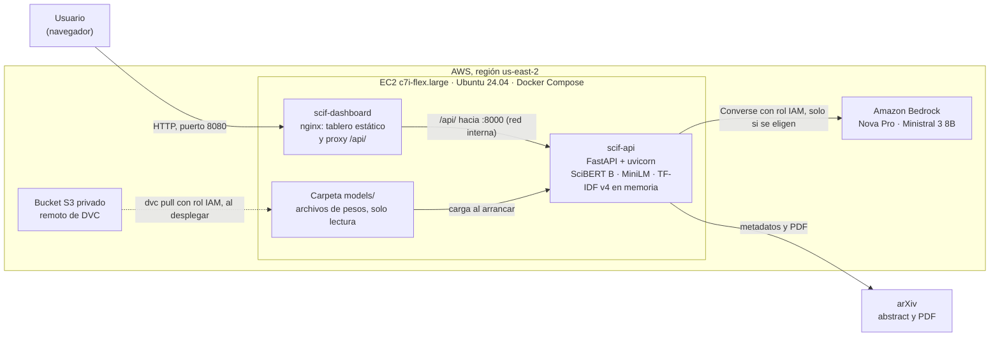
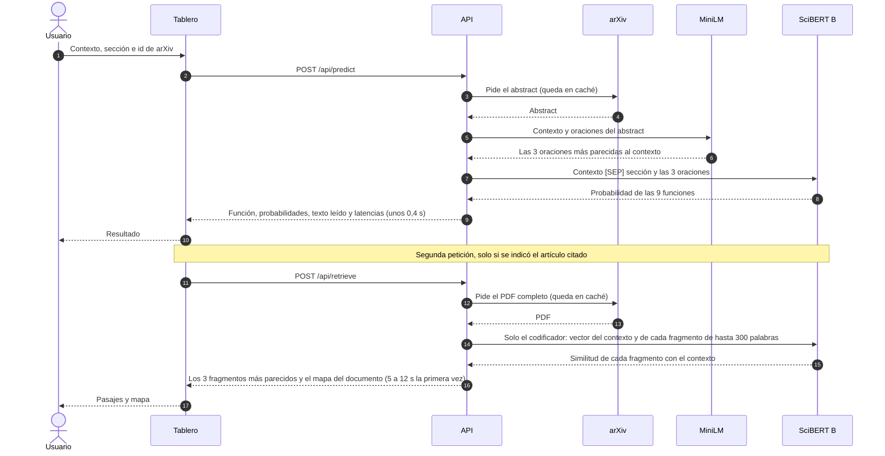
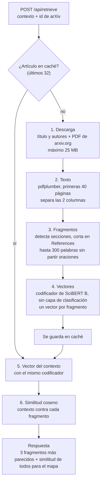

# Clasificación de la función retórica de citas académicas con recuperación de pasajes del documento citado

Proyecto de grado de la Maestría en Inteligencia Artificial (MAIA) de la
Universidad de los Andes, Tema 1. El sistema recibe una cita de un artículo científico
en inglés y predice cuál de 9 funciones retóricas cumple (por ejemplo, si la cita
da antecedentes, sirve de base, se compara o aporta evidencia). También muestra
en qué pasajes del artículo citado se sustenta la cita.

| | |
|---|---|
| Aplicación desplegada | http://3.141.245.118:8080 |
| Documentación de la API | http://3.141.245.118:8080/api/docs |
| Manual de usuario | [`docs/MANUAL_USUARIO.md`](docs/MANUAL_USUARIO.md) |
| Descarga de los modelos (SciBERT y MiniLM, 492 MB) | [modelos.zip](https://scif-dvc-e645d210.s3.us-east-2.amazonaws.com/descargas/modelos.zip) · instrucciones en [«Modelos»](#modelos) |
| Descarga del dataset completo (15 MB comprimido) | [dataset.zip](https://scif-dvc-e645d210.s3.us-east-2.amazonaws.com/descargas/dataset.zip) · muestra y columnas en [`datos/`](datos/) |
| Modelos de lenguaje (Bedrock) | [Sección «Modelos de lenguaje»](#modelos-de-lenguaje) |

## Inicio rápido

Para usarla, abre http://3.141.245.118:8080, pulsa **Ejemplo B** y luego
**Clasificar**. Para levantarla en tu equipo, con Docker:

```bash
git clone https://github.com/MAIA-ProyectoGrado/pds-proyecto-tema1.git && cd pds-proyecto-tema1
curl -O https://scif-dvc-e645d210.s3.us-east-2.amazonaws.com/descargas/modelos.zip && unzip modelos.zip   # opcional: sin ellos sirve el TF-IDF
docker compose up -d --build   # tablero en http://localhost:8080
```

## Contenido

- [Inicio rápido](#inicio-rápido)
- [Problema](#problema)
- [Pregunta de negocio](#pregunta-de-negocio)
- [Alcance](#alcance)
- [Solución](#solución)
- [Uso](#uso)
- [Arquitectura](#arquitectura)
- [Estructura del repositorio](#estructura-del-repositorio)
- [Modelos](#modelos)
- [Modelos de lenguaje](#modelos-de-lenguaje)
- [Ejecutar con Docker](#ejecutar-con-docker)
- [Despliegue en AWS](#despliegue-en-aws)
- [Configuración](#configuración)
- [API](#api)
- [Tamaño, hardware y tiempos](#tamaño-hardware-y-tiempos)
- [Datos y entrenamiento](#datos-y-entrenamiento)
- [Desarrollo sin contenedores](#desarrollo-sin-contenedores)
- [Pruebas](#pruebas)
- [Documentación adicional](#documentación-adicional)

## Problema

Identificar la función de una cita (para qué la usa el autor) apoya la revisión
de literatura y el análisis de impacto, pero es difícil de automatizar: los
contextos de cita son breves y ambiguos, y la información que aclara la función
suele estar en el artículo citado, no en la frase que lo cita.

## Pregunta de negocio

¿Es posible, a partir de artículos científicos en inglés, recuperar
automáticamente los fragmentos más relevantes de un artículo citado y clasificar
el propósito de cada cita (función de cita) para apoyar tareas como la revisión
de literatura y el análisis de impacto bibliométrico?

## Alcance

Construcción de un dataset de intención de cita con 9 clases (contextos de cita
reales, partición sin fuga entre artículos citantes), entrenamiento y comparación
de clasificadores (línea base léxica, embeddings congelados, ajuste fino de
SciBERT y SPECTER), comparación con modelos de lenguaje consultados por API y
despliegue del mejor modelo como servicio.

## Solución

Un clasificador SciBERT ajustado (configuración B) lee la cita junto con la
sección donde aparece y 3 oraciones clave del abstract del artículo citado, y
asigna una de 9 funciones:

`Application`, `Background`, `Basis`, `Comparison`, `Evidence`,
`Further_Reading`, `Gap`, `Identification_of_the_Originator`,
`Modification_Improvement`.

Resultados en el conjunto de prueba (2.241 citas). Cada cita tiene dos etiquetas:
la **revisión humana** del test y la **etiqueta automática** (pre-etiquetado con Llama) con la
que se entrenó y se eligió el modelo. Las dos coinciden en el 73,9 % de las citas.

| Modelo | F1 macro (revisión humana) | Exactitud (revisión humana) | F1 macro (etiqueta automática) | Exactitud (etiqueta automática) |
|---|--:|--:|--:|--:|
| SciBERT configuración B (recomendado) | 0,532 | 0,572 | 0,667 | 0,688 |
| TF-IDF + regresión logística (línea base) | 0,469 | 0,509 | 0,523 | 0,547 |
| Nova Pro, comercial, en Amazon Bedrock | 0,347 | 0,457 | 0,326 | 0,361 |
| Ministral 3 8B, pesos abiertos, en Amazon Bedrock | 0,295 | 0,420 | 0,297 | 0,334 |

Nova Pro y Ministral 3 8B son modelos de lenguaje sin ajuste fino, consultados con
el prompt y los ejemplos de la evaluación (ver [«Modelos de lenguaje»](#modelos-de-lenguaje)).
Sus cifras valen para esas condiciones y para estas dos etiquetas de referencia.

El tablero web permite clasificar una cita con cualquiera de los cuatro modelos,
ver lo que leyó el modelo, la probabilidad de cada función y, aparte, los pasajes
del artículo citado completo más parecidos a la cita. El detalle de las métricas está en
[`docs/modelos_v4/`](docs/modelos_v4/) y la evolución de los modelos en
[`docs/HISTORIAL_MODELOS.md`](docs/HISTORIAL_MODELOS.md).

## Uso

En el tablero (http://3.141.245.118:8080):

1. Pega en **Contexto de cita** una o dos oraciones en inglés donde aparezca la
   cita, o carga uno de los ejemplos.
2. Elige la **sección** del artículo donde aparece la cita. Si no la sabes, elige
   *Otra / no sé*.
3. Recomendado: escribe el **id de arXiv del artículo citado** (por ejemplo
   `1903.10676`) o pega su texto.
4. Deja **SciBERT** como clasificador y pulsa **Clasificar**. El tablero muestra la
   función predicha, la probabilidad de las 9 funciones, un aviso si la predicción
   es ambigua y las oraciones del artículo citado que leyó el modelo. Si indicaste
   el artículo, unos segundos después aparecen los pasajes del artículo completo
   más parecidos a la cita.
5. Para comparar, elige TF-IDF, Nova Pro o Ministral 3 8B y vuelve a clasificar.

La aplicación es abierta: no pide usuario ni contraseña. El paso a paso con
capturas está en el [manual de usuario](docs/MANUAL_USUARIO.md), y el uso de la
API con ejemplos de entrada y salida, en la sección [«API»](#api).

## Arquitectura



- Solo el puerto 8080 es público. La API no se expone: el tablero y la API
  comparten origen a través de nginx, así que no interviene CORS.
- Los modelos son archivos de pesos. La API los carga en memoria al arrancar y
  responde desde ahí; la carpeta se monta en modo solo lectura y no forma parte
  de la imagen.
- La instancia descarga los pesos con un rol IAM de solo lectura: en la máquina
  no hay llaves de AWS. El mismo rol permite consultar en Bedrock solo Nova Pro
  y Ministral 3 8B.

### Flujo de una consulta

Una consulta son dos peticiones a la API. La primera clasifica; la segunda,
que el tablero lanza cuando el resultado ya está en pantalla, busca los pasajes
del artículo completo.



| Modelo | Qué hace en la consulta | ¿Cambia la predicción? |
|---|---|---|
| MiniLM | Elige las 3 oraciones del abstract más parecidas al contexto. No clasifica | Sí, porque decide qué lee SciBERT |
| SciBERT B, completo | Lee el contexto, la sección y las 3 oraciones, y asigna la función | Es la predicción |
| SciBERT B, solo el codificador | Compara el contexto con cada fragmento del PDF para mostrar los pasajes | No: es una explicación para el usuario |
| TF-IDF | Alternativa liviana que se elige en el tablero. Clasifica solo con el contexto y la sección, sin arXiv ni MiniLM. Los pasajes se muestran igual si se indicó el artículo | Es la predicción, si se elige |
| Nova Pro o Ministral 3 8B | Modelos de lenguaje en Bedrock que se eligen en el tablero. Leen el contexto, la sección y el título y el abstract completos del artículo citado, sin MiniLM. Los pasajes se muestran igual | Es la predicción, si se elige |

Los datos del artículo se piden primero a la API de arXiv. Si la API rechaza la
consulta (por ejemplo, con el error 429 por límite de uso) o no responde en 5 s,
se leen de la página del artículo en arxiv.org, que publica el mismo título y
abstract. Si no se indica el artículo citado o arXiv no responde por ninguna de
las dos vías, la API omite los pasos 3 a 6: SciBERT clasifica solo con el
contexto y la sección, y la respuesta explica por qué.

### Pasajes del artículo completo



El paso 4 es el más lento: 4,5 de los 5,8 s que tarda un artículo la primera vez.
Con el artículo en caché, la respuesta toma unos 0,1 s.

Limitaciones conocidas:

- El codificador lee hasta 256 tokens por fragmento, y un fragmento de 300
  palabras tiene unos 400. En los fragmentos largos, la similitud se calcula con
  aproximadamente sus dos primeros tercios; el tablero muestra el texto completo.
- El codificador se ajustó para clasificar la función de la cita, no para medir
  similitud. Los pasajes son una ayuda aproximada para el usuario, no una prueba
  de dónde se sustenta la cita.
- La clasificación y la búsqueda de pasajes comparten el modelo en memoria.
  Mientras se procesa un PDF nuevo, una clasificación simultánea espera hasta
  unos 4,5 s.

## Estructura del repositorio

```
.
├── src/
│   ├── api/          # API de inferencia (FastAPI)
│   └── dashboard/    # tablero web (HTML, CSS y JavaScript)
├── models/           # modelos servidos (SciBERT y MiniLM por DVC, TF-IDF en git) y código de inferencia
├── notebooks/        # construcción del dataset y entrenamiento (Colab)
├── dataset/          # dataset completo (DVC; se descarga con la sección «Modelos»)
├── datos/            # muestra de 90 citas y descripción de las columnas
├── scripts/          # conversión del checkpoint, evaluación, línea base y scripts de la entrega 2
├── docker/           # Dockerfiles y configuración de nginx
├── infra/            # despliegue en AWS (infra/historial/: scripts de la entrega 2)
├── tests/            # pruebas automatizadas (pytest)
├── docs/             # manual de usuario, métricas e historial
├── docker-compose.yml
└── .env.example      # variables de configuración
```

Las tres carpetas que pide el enunciado corresponden a estas:

| Carpeta pedida | Carpeta en el repositorio | Contenido |
|---|---|---|
| `Notebooks/` | [`notebooks/`](notebooks/) | Construcción del dataset y entrenamiento de los 5 clasificadores |
| `Modelos/` | [`models/`](models/) | TF-IDF incluido en git; SciBERT y MiniLM por DVC o con [enlace directo](#modelos) |
| `Datos/` | [`datos/`](datos/) | Muestra de 90 citas y estructura de las columnas; el dataset completo, por DVC o con enlace directo |

`models/` conserva su nombre porque la API, Docker, DVC y las pruebas usan esa ruta.

## Modelos

| Carpeta | Qué es | Tamaño | Cómo se obtiene |
|---|---|--:|---|
| `models/scif-scibert-chunks/` | SciBERT configuración B, el modelo recomendado (110 M de parámetros) | 421 MB | DVC |
| `models/minilm-l6-v2/` | `all-MiniLM-L6-v2`, elige las 3 oraciones clave del abstract (22 M de parámetros) | 88 MB | DVC |
| `models/scif-v4-tfidf-logreg/` | TF-IDF + regresión logística, línea base | 4,7 MB | Incluido en git |

SciBERT y MiniLM están versionados con DVC en un bucket S3 de lectura pública.
Se descargan sin credenciales, de cualquiera de estas dos formas, desde la raíz
del repositorio:

```bash
# Con enlace directo: crea models/scif-scibert-chunks/ y models/minilm-l6-v2/
curl -O https://scif-dvc-e645d210.s3.us-east-2.amazonaws.com/descargas/modelos.zip
unzip modelos.zip

# Con DVC
pip install dvc
dvc pull -r publico models/scif-scibert-chunks.dvc models/minilm-l6-v2.dvc
```

El dataset completo se descarga igual: [`dataset.zip`](https://scif-dvc-e645d210.s3.us-east-2.amazonaws.com/descargas/dataset.zip) o
`dvc pull -r publico dataset.dvc`. Para subir versiones nuevas al bucket se usa el
remoto por defecto (`scif`), que sí necesita credenciales de AWS del proyecto.

**Sin descargar nada**, la aplicación arranca con el TF-IDF. El tablero marca
SciBERT como no disponible e indica qué falta.

El formato de entrada del modelo y la selección de las oraciones clave están
documentados en [`models/README.md`](models/README.md).

## Modelos de lenguaje

Para comparar el clasificador ajustado con modelos que no se entrenaron en la
tarea, el tablero ofrece dos modelos de lenguaje que corren en Amazon Bedrock. No
se descargan: la API los consulta por la red y paga por tokens.

| Modelo | Tipo | F1 macro (revisión humana) | Costo por 1.000 citas | Latencia mediana |
|---|---|--:|--:|--:|
| Nova Pro (`us.amazon.nova-pro-v1:0`) | Comercial | 0,347 | USD 2,49 | 624 ms |
| Ministral 3 8B (`mistral.ministral-3-8b-instruct`) | Pesos abiertos, 8 B parámetros | 0,295 | USD 0,45 | 365 ms |

Son los mejores de cada tipo en la evaluación del conjunto de prueba con 7 modelos
de lenguaje y 4 enfoques de prompt ([`scripts/evaluate_llm.py`](scripts/evaluate_llm.py),
resultados en [`docs/evaluacion_llm/`](docs/evaluacion_llm/)): Nova Pro tuvo el
mayor F1 macro de los 7 y Ministral 3 8B fue el mejor de pesos abiertos de hasta
8 B parámetros. El costo y la latencia son los medidos en esa evaluación; la
latencia es solo la de Bedrock.

Cómo se consultan, igual que en la evaluación:

- Prompt de [`src/api/prompts_llm.py`](src/api/prompts_llm.py) con el enfoque E4
  (definición y criterios de las 9 funciones, y ejemplos resueltos), temperatura 0
  y como máximo 80 tokens de respuesta.
- Entrada: el contexto, la sección y el título y el abstract del artículo citado,
  tomados de arXiv o del texto pegado. No usan las oraciones clave ni MiniLM.
- El modelo responde un puntaje entre 0 y 1 para cada función. La API toma el
  mayor como predicción y como confianza, y marca el caso como ambiguo si hay
  empate o si los dos puntajes mayores difieren en menos de 0,10. El tablero
  muestra los puntajes normalizados a suma 1 para compararlos con los otros
  modelos.

Uso controlado, porque cada consulta tiene costo:

- **Tope diario:** USD 5 por día (UTC) entre los dos modelos. Se suma el costo real
  de cada respuesta, calculado con los tokens que informa Bedrock. Al llegar al
  tope, la API responde `429` hasta las 00:00 UTC; SciBERT y TF-IDF siguen
  disponibles. El acumulado se guarda en el volumen `scif-state`, así que un
  reinicio no lo borra.
- **Consultas por minuto:** 5 por IP, además del límite general de 30.
- **Sin llaves:** en la instancia, la API usa el rol IAM de la instancia, que solo
  puede invocar estos dos modelos. Ninguna llave se escribe en el repositorio ni
  en el servidor.

En una instalación propia los modelos de lenguaje quedan desactivados
(`SCIF_LLM_ENABLED=false`) y el tablero los muestra como no disponibles. Para
activarlos se necesita una cuenta de AWS con acceso a esos dos modelos en Bedrock:

- **En EC2:** desde el equipo local, `./infra/enable_bedrock.sh` agrega el permiso al
  rol de la instancia. `infra/deploy_ec2.sh` los activa por defecto.
- **Sin Docker, en un equipo propio:** con la AWS CLI conectada (`aws login`),
  `SCIF_LLM_ENABLED=true uvicorn src.api.main:app --port 8000`.

## Ejecutar con Docker

Requisitos: Docker con Docker Compose y unos 4 GB de RAM.

```bash
git clone https://github.com/MAIA-ProyectoGrado/pds-proyecto-tema1.git
cd pds-proyecto-tema1
# Modelos: sección «Modelos» (opcional; sin ellos sirve el TF-IDF)
docker compose up -d --build
```

El tablero queda en http://localhost:8080 y la documentación de la API en
http://localhost:8080/api/docs. Las imágenes se construyen en el equipo, así que
la arquitectura (x86_64 o arm64) siempre coincide.

```bash
docker compose ps              # estado y healthcheck
docker compose logs -f api     # registros de la API
docker compose down            # detener
```

| Contenedor | Imagen | Puerto | Función |
|---|--:|---|---|
| `scif-api` | 2,06 GB | 8000, solo red interna | FastAPI con los modelos |
| `scif-dashboard` | 74 MB | 8080 | nginx: sirve el tablero y reenvía `/api/` a la API |

## Despliegue en AWS

La aplicación pública corre en una instancia EC2 `c7i-flex.large` (2 vCPU, 4 GB,
Ubuntu 24.04) en `us-east-2`, con IP elástica. Dos scripts la reproducen:

```bash
# En el equipo local, con la AWS CLI conectada
REGION=us-east-2 ./infra/launch_inference_ec2.sh

# En la instancia
git clone https://github.com/MAIA-ProyectoGrado/pds-proyecto-tema1.git
cd pds-proyecto-tema1 && bash infra/deploy_ec2.sh
```

`launch_inference_ec2.sh` crea el rol IAM, la llave SSH, el grupo de seguridad,
la instancia y la IP elástica, y le da al rol el permiso de Bedrock
(`enable_bedrock.sh`). `deploy_ec2.sh` instala Docker y DVC, descarga los pesos y
levanta los servicios con los modelos de lenguaje activos. El detalle, el costo y cómo borrar los recursos
están en [`infra/README.md`](infra/README.md).

## Configuración

La aplicación se configura con variables de entorno. Para cambiarlas, copia
[`.env.example`](.env.example) como `.env` junto a `docker-compose.yml`. Ese
archivo documenta, con su valor por defecto, las 24 variables de la API, el puerto
público (`SCIF_PORT`) y el servidor de MLflow del entrenamiento. Las principales:

| Variable | Por defecto | Para qué |
|---|---|---|
| `SCIF_PORT` | `8080` | Puerto público del tablero y de la API |
| `SCIF_DEFAULT_MODEL` | `scibert` | Modelo cuando la petición no indica uno (`scibert` o `tfidf-logreg`) |
| `SCIF_WORKERS` | `1` | Procesos de la API; cada uno carga su copia de los modelos |
| `SCIF_TORCH_THREADS` | `min(4, núcleos)` | Hilos de PyTorch por proceso |
| `SCIF_RATE_LIMIT_PER_MIN` | `30` | Peticiones por minuto y por IP a `/predict` y `/retrieve` |
| `SCIF_MAX_CONTEXT_CHARS` | `3000` | Largo máximo del contexto de cita |
| `SCIF_MAX_PDF_MB` / `SCIF_MAX_PDF_PAGES` | `25` / `40` | Límites del PDF del artículo citado |
| `SCIF_LLM_ENABLED` | `false` | Ofrecer Nova Pro y Ministral 3 8B (requiere acceso a Bedrock) |
| `SCIF_LLM_DAILY_BUDGET_USD` | `5` | Gasto máximo por día en los modelos de lenguaje |
| `SCIF_LLM_RATE_LIMIT_PER_MIN` | `5` | Consultas por minuto y por IP a los modelos de lenguaje |

Un valor inválido detiene el arranque de la API con un mensaje que nombra la
variable. La configuración activa se puede consultar en `GET /api/health`.

**Credenciales.** La aplicación no tiene usuarios ni contraseñas, así que no hay
credenciales de prueba, y los modelos y el dataset se descargan sin credenciales.
Solo necesitan credenciales de AWS el despliegue, los modelos de lenguaje en Bedrock
y subir datos al bucket con DVC. En el equipo local se configuran con la AWS CLI
(`aws login` o `aws configure`), y en la instancia las da su rol IAM; nunca se
escriben en el repositorio ni en `.env`.

## API

| Método | Ruta | Qué hace |
|---|---|---|
| `GET` | `/health` | Estado, modelos cargados y configuración activa |
| `GET` | `/models` | Modelos disponibles, qué lee cada uno y las 9 funciones |
| `POST` | `/predict` | Clasifica una cita |
| `POST` | `/retrieve` | Pasajes del artículo citado más parecidos a la cita |

Detrás de nginx, las rutas llevan el prefijo `/api` (por ejemplo,
`/api/predict`). La documentación interactiva está en `/api/docs`.

### Ejemplo: clasificar una cita

```bash
curl -X POST http://3.141.245.118:8080/api/predict \
  -H "Content-Type: application/json" \
  -d '{
        "citation_context": "We extend SciBERT [4] with an additional classification head and fine-tune it on our corpus to improve accuracy.",
        "rhetorical_section": "Methods",
        "arxiv_id": "1903.10676"
      }'
```

Respuesta (resumida):

```json
{
  "predicted_label": "Modification_Improvement",
  "confidence": 0.983,
  "probabilities": {"Modification_Improvement": 0.983, "Application": 0.0081, "Gap": 0.0023, "...": "..."},
  "ambiguous": false,
  "model_id": "scibert",
  "model_version": "v4-config-b",
  "key_sentences": {
    "status": "used",
    "source": "arxiv-abstract",
    "cited_paper": {"id": "1903.10676", "title": "SciBERT: A Pretrained Language Model for Scientific Text"},
    "sentences": [
      {"rank": 1, "text": "We release SciBERT, a pretrained language model based on BERT (Devlin et al., 2018) to address ...", "similarity": 0.6465},
      "..."
    ]
  },
  "input_text": "We extend SciBERT [4] ... [SEP] Section: Methods | Cited passages: We release SciBERT, ...",
  "latency_ms": {"cited_paper": 0.0, "key_sentences": 61.7, "inference": 214.0, "total": 275.8},
  "status": "success"
}
```

Campos de la petición: `citation_context` (obligatorio), `rhetorical_section`,
`model` (`scibert`, `tfidf-logreg`, `nova-pro` o `ministral-3-8b`) y el artículo
citado como `arxiv_id` (id o URL) o `cited_text` (texto pegado).

Con `"model": "nova-pro"` o `"ministral-3-8b"`, la respuesta tiene la misma forma.
`key_sentences.status` es `abstract_used` y trae el título y el abstract que leyó
el modelo, y se agrega el bloque `llm`:

```json
"llm": {
  "provider": "Amazon Bedrock",
  "bedrock_model_id": "us.amazon.nova-pro-v1:0",
  "approach": "E4",
  "scores": {"Background": 0.2, "Gap": 0.0, "Basis": 0.7, "...": "..."},
  "raw_response": "[0.2, 0.0, 0.7, 0.1, 0.6, 0.0, 0.0, 0.0, 0.0]",
  "input_tokens": 3100,
  "output_tokens": 45,
  "cost_usd": 0.002624,
  "spent_today_usd": 0.0026,
  "daily_budget_usd": 5.0
}
```

### Ejemplo: pasajes del artículo completo

```bash
curl -X POST http://3.141.245.118:8080/api/retrieve \
  -H "Content-Type: application/json" \
  -d '{"citation_context": "We extend SciBERT [4] with an additional classification head ...", "arxiv_id": "1903.10676", "top_k": 3}'
```

Devuelve los datos del artículo, los `top_k` fragmentos más parecidos (con su
sección y similitud coseno), la similitud de todos los fragmentos para el mapa
del documento y la latencia de cada etapa.

### Errores

| Código | Cuándo |
|---|---|
| `400` | El contexto de cita está vacío, o `/retrieve` no recibió el artículo citado |
| `404` | arXiv no tiene ningún artículo con ese id |
| `413` | La petición supera 1 MB |
| `422` | Faltan campos o no son válidos; el mensaje dice cuál |
| `429` | Se superó el límite de peticiones por minuto o, con los modelos de lenguaje, su límite por minuto o el tope diario |
| `502` | No se pudo descargar el PDF de arXiv, Bedrock no respondió, o el modelo de lenguaje no devolvió la lista de 9 puntajes |
| `503` | Faltan los pesos del modelo pedido, o los modelos de lenguaje están desactivados; el mensaje explica qué hacer |

## Tamaño, hardware y tiempos

Medido en la instancia de producción (`c7i-flex.large`: 2 vCPU Intel Xeon
Platinum 8488C, 3,7 GB de RAM, sin GPU).

| Recurso | Valor |
|---|--:|
| Memoria de la API con SciBERT y MiniLM cargados | ~0,8 GB |
| Memoria del sistema completo | 1,4 de 3,7 GB |
| Imagen de la API / del tablero | 2,06 GB / 74 MB |
| Disco recomendado | 30 GB |

| Escenario (60 citas del test, una a la vez) | Mediana | Percentil 95 |
|---|--:|--:|
| SciBERT sin artículo citado: inferencia | 135 ms | 197 ms |
| SciBERT con abstract: total de la API | 383 ms | 518 ms |
| TF-IDF: inferencia | 1 ms | 1 ms |
| Pasajes del artículo completo, primera vez | 5,8 s | |

Con 2 vCPU la API atiende unas 2,5 clasificaciones por segundo. Con 4 peticiones
simultáneas cada una tarda en promedio 1,5 s. Para atender más usuarios hacen
falta más núcleos o varias instancias detrás de un balanceador; el número de
procesos se ajusta con `SCIF_WORKERS`.

**Estrategia de despliegue.** El modelo se sirve en CPU tal como se evaluó, sin
cuantizar: la clasificación completa responde por debajo de 1 s. La lectura del
artículo completo, que es lo más lento, va en una petición aparte, para no
retrasar la clasificación. Si faltan los pesos de SciBERT, la aplicación sigue
funcionando con el TF-IDF, que ocupa 4,7 MB y responde en 1 ms. Los modelos de
lenguaje no se cargan en la instancia: se consultan como servicio en Bedrock, con
tope de gasto, así que no exigen GPU ni memoria adicional. En la evaluación,
Bedrock respondió en una mediana de 624 ms con Nova Pro y 365 ms con Ministral 3 8B.

## Datos y entrenamiento

El dataset tiene 14.937 citas en 9 clases, tomadas de SciCite, SciTail, Semantic
Scholar y ACL-ARC, y particionadas por artículo citante sin fugas entre
particiones: 10.416 de entrenamiento, 2.280 de validación y 2.241 de prueba. Un
integrante del equipo revisó a mano las 2.241 citas de prueba: su etiqueta está en
la columna `human_label`, junto a la etiqueta automática (`label`) y a su certeza
(`certeza_evaluacion`: `ALTA_CERTEZA` si el puntaje de Llama para esa etiqueta es
de al menos 0,70, `DUDA` si no). Dos integrantes anotaron el test por separado
siguiendo la [guía de anotación](docs/anotacion/GUIA_ANOTACION.md); el acuerdo
entre ellos es kappa de Cohen 0,608 ([detalle](docs/anotacion/acuerdo_humano.md)). Las particiones están versionadas con DVC en
`dataset/` (`dvc pull -r publico dataset.dvc`). La carpeta [`datos/`](datos/) trae una
muestra de 90 citas y la descripción de cada columna.

| Notebook | Qué hace |
|---|---|
| [`Obtener_dataset.ipynb`](notebooks/Obtener_dataset.ipynb) | Construye el dataset final: ingesta de las fuentes, etiquetado con Llama 3.2 3B y rescate por puntajes, balanceo, partición sin fugas y selección de las 3 oraciones clave con MiniLM |
| [`Entrenamiento_clasificadores_scibert_mlflow.ipynb`](notebooks/Entrenamiento_clasificadores_scibert_mlflow.ipynb) | Entrena y compara 5 configuraciones (SciBERT A y B, SPECTER, encoder congelado y pérdida sin ponderar) con seguimiento en MLflow, en una GPU L4 de Colab |
| [`procesamiento.ipynb`](notebooks/procesamiento.ipynb) | Versión anterior del corpus (entrega 2), conservada como referencia |

El ajuste fino corrió en Google Colab con una GPU NVIDIA L4: secuencias de hasta
512 tokens, lote de 16, 4 épocas y AdamW con tasa de aprendizaje 2e-5, decaimiento
de pesos 0,01 y calentamiento lineal del 10 %. Cada época tomó de 7 a 7,5 min, unos
29 min por corrida. El control con el encoder congelado entrenó solo la capa de
clasificación (3 épocas, tasa 1e-4) en unos 8 min.

Los notebooks corren en Google Colab y leen las llaves de Hugging Face y Semantic
Scholar desde los secretos de Colab.

Scripts de la versión final:

| Script | Qué hace |
|---|---|
| `scripts/convert_checkpoint.py` | Convierte el checkpoint `.pt` al formato de Hugging Face |
| `scripts/download_encoder.py` | Descarga MiniLM para uso sin conexión |
| `scripts/evaluate_v4.py` | Evalúa SciBERT en validación y prueba y escribe `docs/modelos_v4/` |
| `scripts/evaluate_test_humano.py` | Compara SciBERT y TF-IDF contra las dos etiquetas del test, por certeza y con y sin SciTail (`docs/modelos_v4/test_referencias_metricas.json`) |
| `scripts/calcular_kappa.py` | Calcula el acuerdo entre los dos anotadores del test (kappa de Cohen global y por función) |
| `scripts/extraer_corridas_notebook.py` | Lee las salidas del notebook de entrenamiento y genera las curvas de aprendizaje de las 5 corridas, la tabla de F1 por clase (validación y test) y las matrices de confusión del test (`docs/modelos_v4/`) |
| `scripts/evaluate_jueces.py` | Esquema de jueces del pre-etiquetado: tres modelos abiertos en Bedrock clasifican las 14.937 citas con el prompt del pre-etiquetado; calcula el acuerdo entre jueces y el voto de mayoría (`docs/jueces/`). Dependencias en `requirements-llm.txt` |
| `scripts/train_tfidf_v4.py` | Entrena la línea base TF-IDF |

Los demás scripts de `scripts/` (`train.py`, `eval_v2.py`, `extract_arxiv_data.py`
y otros) corresponden a los modelos v1 a v3 de la entrega 2.

## Desarrollo sin contenedores

```bash
python3.12 -m venv .venv-api && source .venv-api/bin/activate
pip install -r src/api/requirements.txt

uvicorn src.api.main:app --port 8000      # API
python src/dashboard/serve.py             # tablero en http://127.0.0.1:8080 (otra terminal)
```

En Windows (Git Bash), el entorno se crea y se activa así:

```bash
python -m venv .venv-api
source .venv-api/Scripts/activate
```

## Pruebas

```bash
pip install -r requirements-dev.txt
pytest
```

`requirements-dev.txt` no incluye PyTorch: así corre el flujo de GitHub Actions
([`.github/workflows/tests.yml`](.github/workflows/tests.yml)) en cada push y
pull request a `main`. Sin los pesos se omiten las 9 pruebas que necesitan
SciBERT o MiniLM. Con el entorno de la API (`src/api/requirements.txt`) y los
pesos descargados corren las 172. Si están los pesos pero falta PyTorch, una
prueba falla e indica qué instalar. Las pruebas de los modelos de lenguaje
([`tests/test_llm.py`](tests/test_llm.py)) usan un cliente de Bedrock simulado:
no hacen llamadas reales ni tienen costo.

## Documentación adicional

- [`docs/MANUAL_USUARIO.md`](docs/MANUAL_USUARIO.md): uso del tablero paso a paso.
- [`models/README.md`](models/README.md): formato de entrada y artefactos de cada modelo.
- [`docs/HISTORIAL_MODELOS.md`](docs/HISTORIAL_MODELOS.md): todas las versiones del modelo y sus métricas.
- [`infra/README.md`](infra/README.md): despliegue en AWS y borrado de recursos.
- [`docs/historial/`](docs/historial/): EDA y modelos de la entrega 2.
