# Manual de usuario del tablero

## Para qué sirve

Al leer un artículo científico aparecen citas como *«We extend SciBERT [4] with an
additional classification head…»*. El tablero responde dos preguntas sobre ellas:

1. **¿Para qué se cita ese trabajo?** Clasifica la cita en una de 9 funciones
   retóricas.
2. **¿En qué parte del artículo citado está lo que se cita?** Muestra los pasajes
   del artículo completo más parecidos a la cita.

Está pensado para quien revisa literatura científica. Funciona **solo con textos
en inglés**, el idioma con el que se entrenó el modelo.

Se abre en http://3.141.245.118:8080, o en `http://localhost:8080` si se ejecuta
en el propio equipo (ver el [README](../README.md)).

## La pantalla

A la izquierda se escribe la cita y se eligen las opciones; a la derecha aparecen
las instrucciones y los resultados. El recuadro **Cómo usar el tablero** resume los
pasos y se puede plegar. **Las 9 funciones de cita** despliega la definición de
cada categoría.

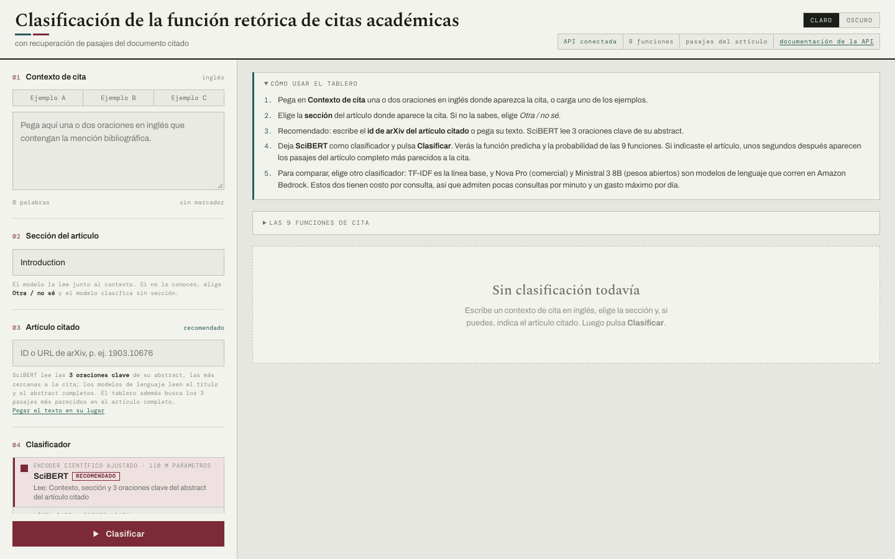

Arriba a la derecha:

- **Claro / Oscuro** cambia el tema de color.
- **API conectada** indica que el servicio responde. Si dice *servicio parcial*,
  falta algún componente y un aviso explica cuál.
- **pasajes del artículo** indica si está disponible la búsqueda en el artículo
  completo.
- **documentación de la API** abre la documentación interactiva del servicio.

## Cómo usarlo

### 1. Contexto de cita

Pega una o dos oraciones en inglés que contengan la cita. Los botones
**Ejemplo A**, **B** y **C** cargan casos listos para probar. Debajo del campo se
cuentan las palabras y se indica si se detectó un marcador de cita, como `[4]` o
`(Devlin et al., 2019)`.

### 2. Sección del artículo

Elige la sección del artículo donde aparece la cita: Introduction, Methods,
Results y otras. El modelo la lee junto con el contexto. Si no la sabes, elige
**Otra / no sé** y el modelo clasifica sin sección.

### 3. Artículo citado (recomendado)

Escribe el identificador de arXiv del artículo citado (por ejemplo, `1903.10676`)
o su URL. Con él:

- SciBERT lee las **3 oraciones del abstract** más parecidas a la cita, como en su
  entrenamiento.
- El tablero busca después los **3 pasajes del artículo completo** más parecidos a
  la cita.

Si el artículo no está en arXiv, usa **Pegar el texto en su lugar** y pega su
abstract o su texto completo. Para buscar pasajes se necesitan al menos 50
palabras.

### 4. Clasificador

| Opción | Qué lee | Cuándo usarla |
|---|---|---|
| **SciBERT** (recomendado) | El contexto, la sección y las 3 oraciones clave del abstract | Siempre que esté disponible: es el modelo más preciso |
| **TF-IDF + Regresión Logística** | El contexto y la sección | Como línea base para comparar |

Si los pesos de SciBERT no están instalados en el servidor, la opción aparece
deshabilitada con el motivo y un enlace a las instrucciones para descargarlos.

### 5. Clasificar

Pulsa **Clasificar**. La función aparece en menos de un segundo. Si indicaste el
artículo citado, los pasajes llegan unos segundos después: la primera vez que se
consulta un artículo hay que descargar y leer su PDF.

## Cómo leer los resultados

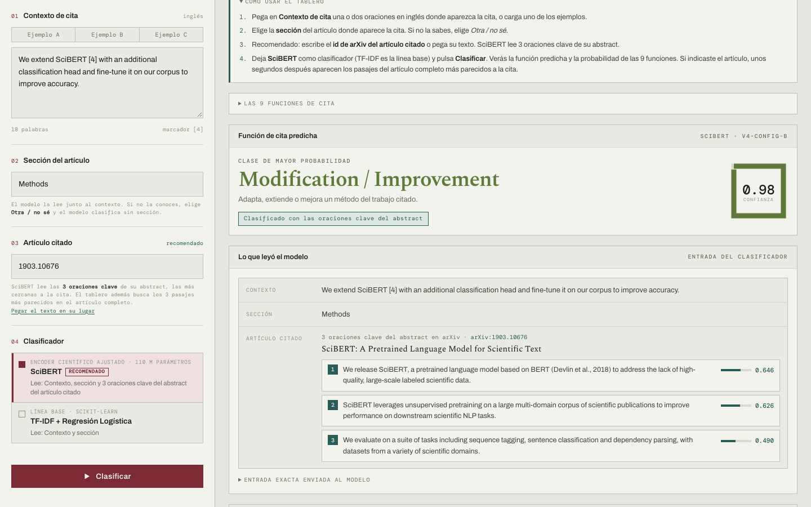

### Función de cita predicha

La función con mayor probabilidad, su definición y la **confianza** (la
probabilidad de esa función, entre 0 y 1). La etiqueta debajo indica con qué se
clasificó: *con las oraciones clave del abstract* o *solo con el contexto y la
sección*.

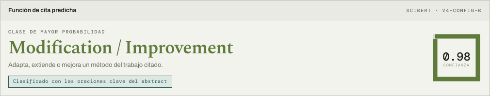

Si las dos funciones más probables están a menos de 0,10 de diferencia, el
tablero marca el caso como **ambiguo**: conviene revisar las dos.

### Lo que leyó el modelo

El contexto, la sección y las 3 oraciones clave del abstract, con su parecido a la
cita (de 0 a 1). **Entrada exacta enviada al modelo** muestra el texto tal como lo
recibió SciBERT.

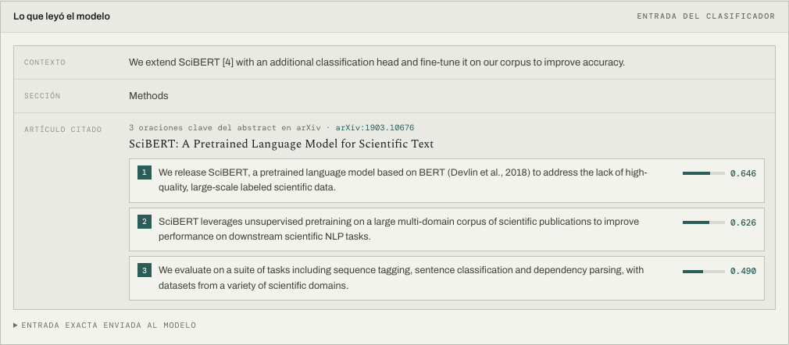

Si no indicaste el artículo citado, o no se pudo leer, el panel lo dice y el modelo
clasifica solo con el contexto y la sección:

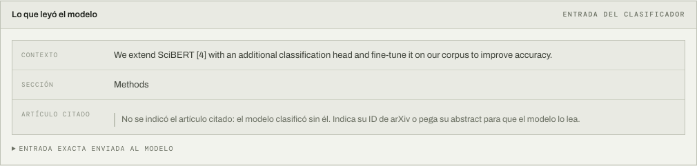

### Distribución sobre las 9 funciones

La probabilidad que el modelo asigna a cada función. Sirve para ver si hubo una
segunda opción cercana.

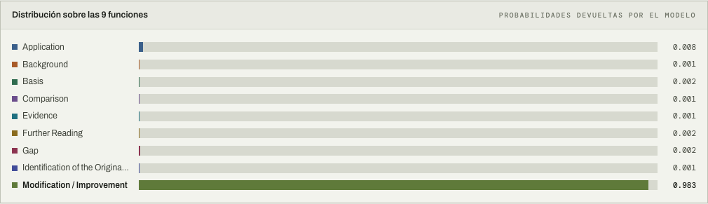

### Dónde se sustenta en el artículo completo

Los 3 fragmentos del artículo citado, de hasta 300 palabras, más parecidos a la
cita, con su sección y su similitud. Es una ayuda para ubicar la idea citada: los
fragmentos más parecidos no garantizan que la cita se apoye justo ahí. Este paso
**no cambia la predicción**.

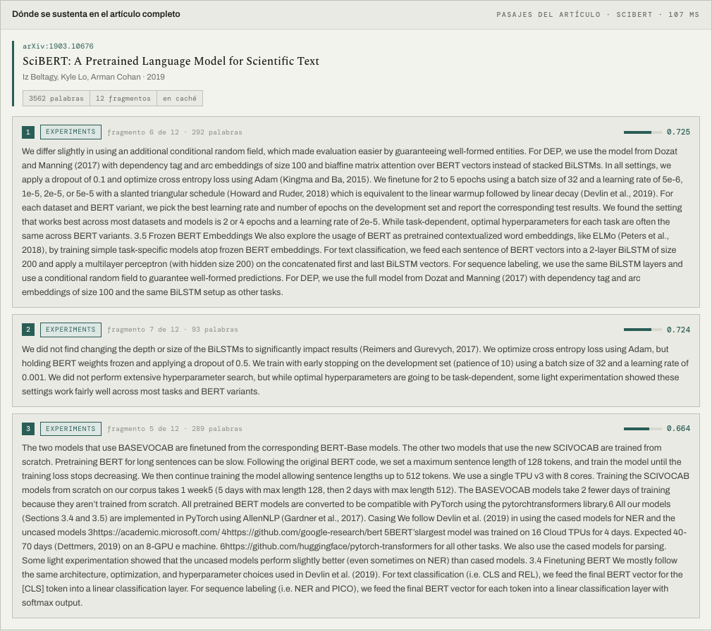

### Mapa del artículo citado

Cada barra es un fragmento del artículo, en orden, agrupado por secciones. La
altura es su similitud con la cita. Los 3 fragmentos mostrados arriba aparecen
resaltados y numerados.

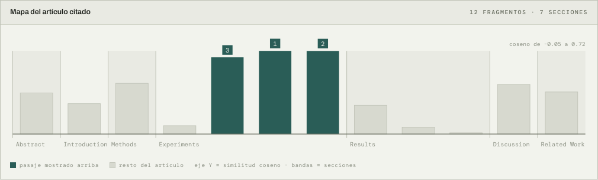

### Ejecución

El modelo usado y el tiempo de cada etapa de la consulta: el artículo citado, las
oraciones clave, la clasificación, el total y los pasajes.

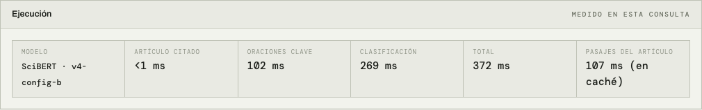

## Si algo sale mal

El tablero no deja en pantalla resultados viejos: ante un fallo retira la
predicción anterior y explica qué pasó.

| Mensaje | Qué significa | Qué hacer |
|---|---|---|
| *Falta el contexto de cita* | El campo está vacío | Escribir la cita |
| *La API no responde* | El servicio está caído o reiniciándose | Esperar un momento y reintentar; si sigue, avisar a quien administra el despliegue |
| *arXiv no tiene ningún artículo con id…* | El identificador no existe | Revisarlo en arxiv.org |
| *… no es un identificador de arXiv válido* | Formato incorrecto | Usar `1903.10676` o la URL completa |
| *No se pudieron buscar los pasajes* | No se pudo descargar o leer el PDF | Pegar el texto del artículo en su lugar |
| *Demasiadas peticiones* (429) | Se superó el límite de 30 consultas por minuto | Esperar un minuto |

Si falla el artículo citado, **la clasificación sigue siendo válida**: el modelo
clasifica sin él y el panel lo indica.

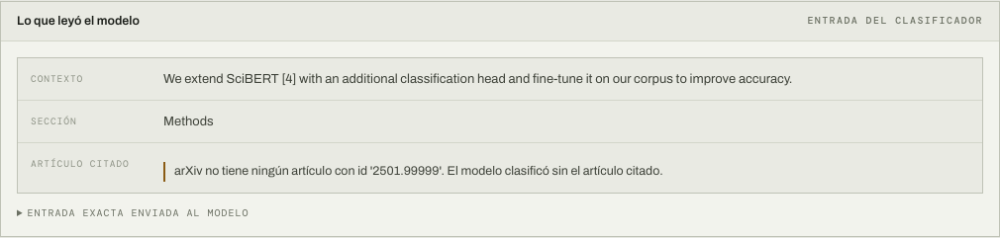

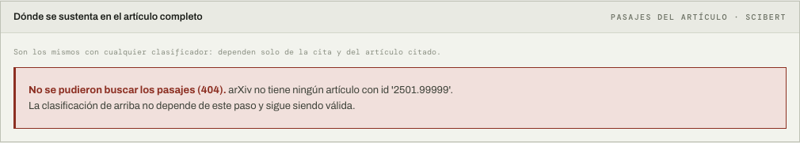

## Qué esperar del sistema

- **El modelo se equivoca.** En las 2.241 citas de prueba revisadas por el equipo
  acierta el 69 % (F1 macro de 0,667): aproximadamente una de cada tres
  predicciones es incorrecta. Es una ayuda para revisar literatura, no un
  veredicto; la distribución y el aviso de ambigüedad sirven para juzgar cuánto
  confiar en cada resultado.
- **Las funciones más difíciles** son *Modification / Improvement* (F1 de 0,52) y
  *Further Reading* (0,56). Las más fiables son *Evidence* (0,83) y *Gap* (0,74).
- **Solo funciona en inglés.**
- **La lectura del PDF no es perfecta.** En tablas, fórmulas y notas al pie los
  fragmentos pueden traer texto mezclado.
- **Necesita conexión a arXiv** para leer el artículo citado. Sin ella, clasifica
  con el contexto y la sección.
